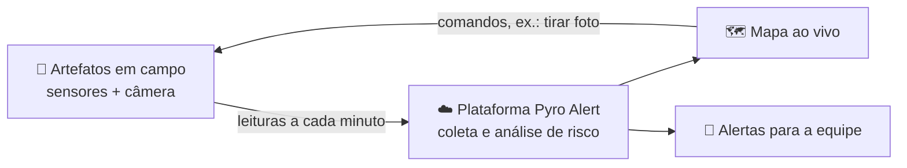

# Pyro Alert

**🌱 Antecipando chamas para um futuro mais verde**

Monitoramento de focos de incêndio com sensores em campo, mapa em tempo real e alertas automáticos.

[Instagram](https://www.instagram.com/pyroalert) · [pyroalertpessoal@gmail.com](mailto:pyroalertpessoal@gmail.com)

## 🔥 O problema

Um incêndio em área de vegetação começa pequeno. Com calor, ar seco e vento, ele se espalha
rápido, e quanto antes é percebido, mais fácil é controlar. Muitas vezes, porém, o aviso só chega
quando a fumaça já é visível de longe.

## 💡 A nossa ideia

Instalar **artefatos**, pequenos dispositivos com sensores, nas áreas de risco. Eles medem o
ambiente o tempo todo e enviam os dados para a plataforma Pyro Alert, que:

- mostra cada artefato num **mapa ao vivo**, com a cor do seu estado;
- **avalia o risco de incêndio** combinando as leituras: ar quente e seco ao mesmo tempo,
  fumaça aumentando, solo ressecado;
- **avisa a equipe** assim que o risco aparece;
- percebe quando um artefato **para de responder durante uma situação de risco**, sinal de que
  ele pode ter sido atingido pelo fogo;
- permite **pedir uma foto** do local pela câmera do artefato, para confirmar o que está acontecendo.

## 📡 O que os artefatos medem

| Sensor | Por que importa |
|---|---|
| 🌡️ Temperatura do ar | O calor favorece o início e a propagação do fogo |
| 💧 Umidade do ar | Ar seco deixa a vegetação mais inflamável |
| 🌱 Temperatura e umidade do solo | Solo quente e seco indica vegetação vulnerável |
| 💨 Fumaça | Sinal direto de queima |
| 🧪 Gases inflamáveis | Gases que aparecem com a queima ou que facilitam a combustão |
| 📷 Câmera | Foto do local sob demanda |

Cada artefato pode ter uma combinação diferente de sensores, de acordo com o local onde é instalado.

## ⚙️ Como funciona

## 🛠️ Tecnologias

## 📂 Como o projeto é organizado

| Repositório | O que faz |
|---|---|
| [pyro-firmware](https://github.com/Pyro-Alert/pyro-firmware) | Programa dos artefatos: lê os sensores, envia os dados, tira fotos e se atualiza pela internet |
| [pyro-contracts](https://github.com/Pyro-Alert/pyro-contracts) | O formato oficial das mensagens entre os artefatos e a plataforma |
| [pyro-ingest](https://github.com/Pyro-Alert/pyro-ingest) | Recebe as leituras, avalia o risco de incêndio e dispara os alertas |
| [pyro-api](https://github.com/Pyro-Alert/pyro-api) | Usuários e permissões, cadastro de artefatos, histórico e comandos |
| [pyro-web](https://github.com/Pyro-Alert/pyro-web) | O site: mapa ao vivo, gráficos dos sensores e painel do administrador |
| [pyro-infra](https://github.com/Pyro-Alert/pyro-infra) | Infraestrutura, ambiente de desenvolvimento e simulador de artefatos |
| [pyro-ci](https://github.com/Pyro-Alert/pyro-ci) | Padrões de qualidade e automações compartilhadas por todos os repositórios |

Os repositórios do produto são privados e visíveis só para a equipe.

## 👥 Equipe

<table>
  <tr>
    <td align="center" width="160">
      <a href="https://github.com/Rvjq">
         
        <b>Rafael</b>
      </a>
    </td>
    <td align="center" width="160">
      <a href="https://github.com/RebecaLyra">
         
        <b>Rebeca Lyra</b>
      </a>
    </td>
    <td align="center" width="160">
      <a href="https://github.com/Vinicius-DAS">
         
        <b>Vinicius Diniz</b>
      </a>
    </td>
  </tr>
</table>

## 📬 Contato

- Instagram: [@pyroalert](https://www.instagram.com/pyroalert)
- E-mail: [pyroalertpessoal@gmail.com](mailto:pyroalertpessoal@gmail.com)
